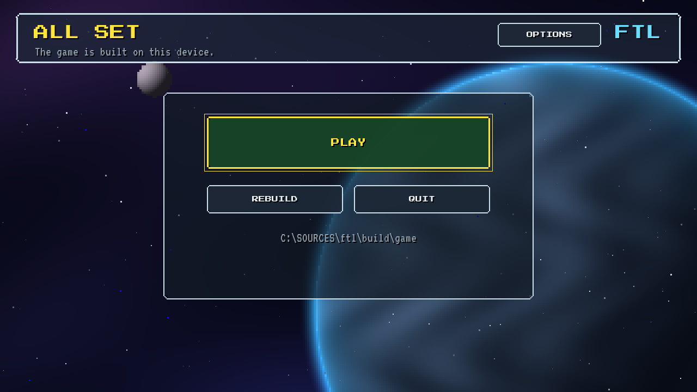
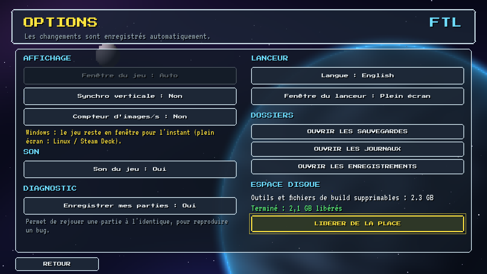

# FTL (iPad 1.5.10) — native PC / Linux port by static recompilation

*[Version française](README.fr.md)*

<a href="https://recomplauncher.com"><picture><source media="(prefers-color-scheme: dark)" srcset="https://recomplauncher.com/assets/press/launcher/badge-light.svg"></picture></a>

This repository builds a native executable for Windows and Linux (Steam Deck) **from your own copy** of the IPA of *FTL: Faster Than Light*
(iPad, version 1.5.10). The ARM code is translated to C ("static recompilation") and compiled together with a host runtime
(files, threads, OpenGL ES 2 → desktop OpenGL, sound, input). A French translation is included (see below).

> **No game content is in this repository**: no IPA, no `ftl.dat`, no C code generated from the binary, no images or sounds.
> You must own the game. Everything generated stays in the `build/` folder (ignored by git).

## Download (no Python needed)
Each release has two packages with their own Python; **no game content inside**, you still need your own IPA:
- **Windows**: `FTL-Recomp-<version>-windows-x64.zip` — unzip, run `play.bat`.
- **Steam Deck / Linux**: `FTL-Recomp-<version>-linux-x86_64.AppImage` — `chmod +x`, then run it (on the Deck, add it as a non-Steam game). Or the same folder as `FTL-Recomp-<version>-linux-x86_64.tar.gz`: unpack it and run `AppRun`. Their data (tools, your IPA, the built game) lives in `~/.local/share/ftl-recomp/` (`FTL_HOME` to change); the program folder itself is never written to.

They are built by the **Packages** GitHub Action (`.github/workflows/release.yml`, `packaging/make_dist.py`): run it by hand, or push a tag `v*` to publish a release.

## RecompLauncher
This project supports [RecompLauncher](https://recomplauncher.com): `recomplauncher.json` (shipped at the top of every release package) lets it check your IPA, build the game
(a windowless setup step with progress), start it, and show the game options on its page. The optional second file is your PC `ftl.dat` for the French text.
Everything is kept in the launcher's `{data}` folder. Without RecompLauncher nothing changes: `python play.py`, `--prepare` and `--play` are the only entry points,
and `--data DIR` (or `FTL_HOME`) moves tools, build and settings anywhere.

## Requirements
**Python 3.11+ and an Internet connection. Nothing else to install or download by hand.**
On first run, `bootstrap.py` fetches the following into `./tools/` (ignored by git); every archive is verified by SHA-256:

| Dependency | Purpose | Size |
|---|---|---|
| Ghidra 12.2 | analysis of the iOS binary | ≈ 570 MB |
| Temurin JDK 25 | runs Ghidra | ≈ 140 MB |
| Zig 0.17.1 | portable C compiler (Windows and Linux) | ≈ 60-100 MB |
| SDL2 2.32.4 headers (Linux) | compiles the runtime | 8 MB |
| Pillow, fontTools (PyPI wheels) | French patch | ≈ 10 MB |

On Linux, the system SDL2 and OpenGL runtime must be present (it is on a desktop Linux and on the Steam Deck).
You can also provide your own tools: `--ghidra DIR`, `--jdk DIR`, `--compiler system` (Visual Studio / gcc+make), `--no-download`.

**Your IPA**: `FTL__Faster_Than_Light_1.5.10_ios_6.0.ipa` (version 1.5.10, **decrypted**), with exactly the SHA-256 listed in
[`work/recomp/binary.toml`](work/recomp/binary.toml) (`62bfa1cc…ea3e81b9`): several addresses of the binary are used by the runtime.

## Simple use: the graphical launcher
```
python play.py        (Windows: double-click play.bat; Linux / Steam Deck: play.sh)
```
On the **first launch** (no game built yet), a screen walks you through three steps: your IPA (dropped in the `ipa/` folder, dragged onto the window,
found automatically in Downloads, on a USB stick..., or picked with "Browse"), your PC copy of FTL for the French text (detected automatically if present),
then **Build the game**: a progress bar shows each stage. After that, the **Play** screen starts the game (you can change language or rebuild).
Keyboard, mouse, **gamepad** (Steam Deck) and drag-and-drop are supported. An **OPTIONS** button (on every screen) lets you set: game window mode
(Linux/Steam Deck), vertical sync, FPS counter, sound, **game recording** (to reproduce a bug), launcher language and window, opening the folders
(saves, logs, recordings) and **freeing disk space** (Ghidra, Java, compiler and build files, ~2 GB, once the game is built).
Settings live in `settings.ini` and are passed to the game when it starts.
The interface is in **English** by default (`--lang fr` or `FTL_LANG=fr` for French). `python play.py --demo` shows the flow with a fake build;
`--shots DIR` writes a screenshot of every screen; `--selftest` tests the screen flows.
SDL2 (pysdl2) and two free fonts (Press Start 2P, VT323; OFL licence) are downloaded into `tools/` like everything else.

### Launcher screenshots
(The screenshots use the background generated by the launcher; on your machine the background is cut from your own IPA.)

| First launch | Ready to build |
|---|---|
|  |  |

| Building | Ready to play |
|---|---|
|  |  |

| Options (English) | Options (French) |
|---|---|
|  |  |

Other screens: [wrong IPA](docs/screenshots/4_wrong_ipa.png), [no PC FTL](docs/screenshots/5_no_pc_ftl.png), [browse](docs/screenshots/6_browse.png), [build error](docs/screenshots/9_error.png), [free up space](docs/screenshots/14_confirm_free_space.png).

## Command-line use
```
python build_from_ipa.py --ipa FTL__Faster_Than_Light_1.5.10_ios_6.0.ipa
python build_from_ipa.py --ipa ... --pc-ftl-dat auto                                # with the French translation (looks for your PC FTL)
python build_from_ipa.py --ipa ... --pc-ftl-dat "C:/Games/FTL/ftl.dat.vanilla"     # or give the file
```
The game, ready to run, is in `build/game/` (`lancer_ftl.bat` on Windows, `run.sh` on Linux).
Stages (`--only` / `--skip`): `extract` → `ghidra` → `lift` → `patch` → `compile` → `game` → `fr`.
On Linux the build runs at **minimum priority** (nice 19, ionice idle) on half the cores only, so it does not disturb the machine (`--jobs N`, `--no-nice` to change that).
Duration: about 15 minutes of computing, plus the downloads of the first run. The Ghidra/Lift stages are cached (`--force` to redo them).

## French translation
`--pc-ftl-dat` points to the `ftl.dat` of **your** PC version of FTL that contains the official French text (vanilla, unmodded). It is only read, never written.
With `auto`, [`detect_pc_ftl.py`](detect_pc_ftl.py) looks for your installation (GOG, Steam, Steam Deck libraries, Heroic, usual folders), opens each archive to check that
`data/text-fr.xml` is present, and prefers the original version (`ftl.dat.vanilla`) over a modded one (Multiverse). `python detect_pc_ftl.py` prints what it finds.
The texts (≈ 94 % of the strings), the fonts (accents) and 29 button/banner images are reused or recomposed; see [`work/fr/LISEZMOI.md`](work/fr/LISEZMOI.md) (in French).
Still in English: text drawn inside the big atlases (hangar, HUD) and a few strings hard-coded in the executable.

## Repository contents
- `build_from_ipa.py` — the whole pipeline.
- `work/scripts/` — Ghidra scripts: `Lift.java` (the ARM → C translator), `FixSwitch.java` (switch tables), analysis tools.
- `work/recomp/` — host runtime (`rt.c`, `hle_*.c`, `gl_host.c` + `gl_sdl.inc`, `plat.h` for Windows/Linux portability), `binary.toml`
  (binary-specific addresses), `patches_apres_lift.py`, build scripts.
- `work/fr/` — translation patch. `steamdeck/` — Linux launchers. `NOTES-ANDROID.md` — detailed technical log (in French).

## Built-in test tools
Environment variables: `FTL_FRAMES=n` (stop after n frames), `FTL_SEED`, `FTL_FIXEDTIME=1`, `FTL_SHOT=a,b,c` (screenshots),
`FTL_CLICK="frame,x,y;…"`, `FTL_FPS=1`, `FTL_NOSOUND=1`, `FTL_WINDOWED=1` / `FTL_FULLSCREEN=1` (Linux).
**Record / replay**: `FTL_RECORD=auto` records the inputs and the seed into `replays/`; `FTL_REPLAY=<folder>` replays the game exactly
(useful to reproduce a crash).

## Licence and notices
The code in this repository (translator, runtime, scripts) is meant for preservation and interoperability; the licence is still to be chosen by the author.
*FTL: Faster Than Light* belongs to Subset Games. The SIL library, used by the game, has its own licence and is not included.
