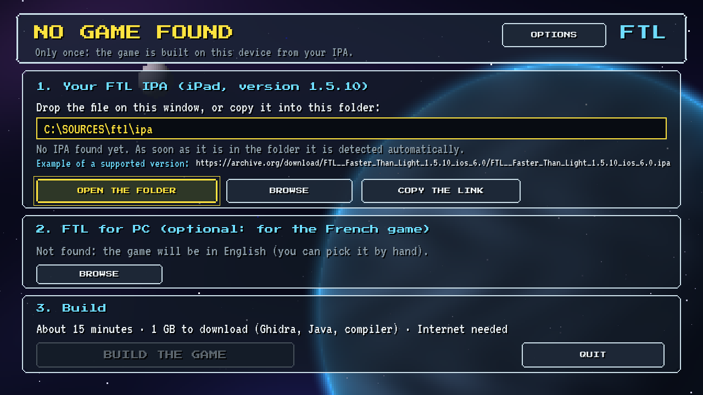
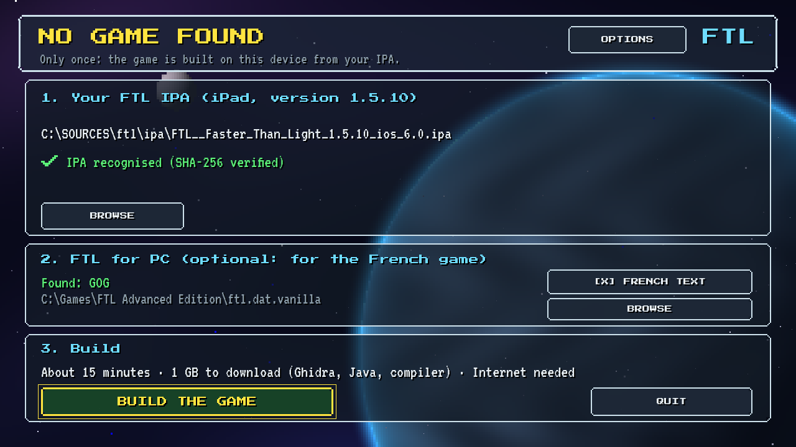
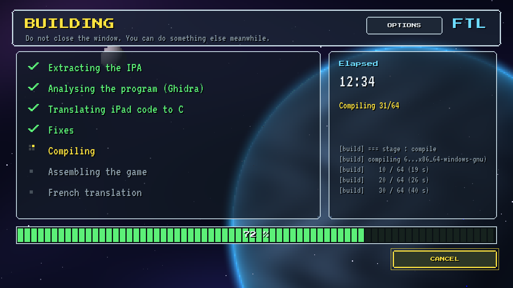
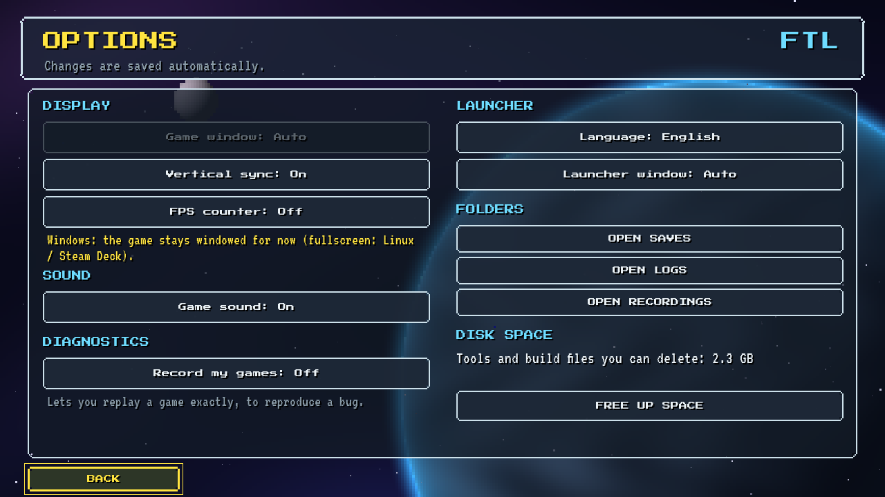

# FTL (iPad 1.5.10) — port PC / Linux par recompilation statique

Ce dépôt reconstruit **à partir de votre propre copie** de l'IPA de *FTL: Faster Than Light* (iPad, version 1.5.10) un exécutable natif
pour Windows et Linux (Steam Deck). Le code ARM est traduit en C (« recompilation statique ») puis compilé avec un runtime hôte
(fichiers, threads, OpenGL ES 2 → OpenGL de bureau, son, entrées). Une traduction française est incluse (voir plus bas).

> **Aucun contenu du jeu n'est dans ce dépôt** : ni l'IPA, ni `ftl.dat`, ni le code C généré à partir du binaire, ni les images/sons.
> Vous devez posséder le jeu. Tout ce qui est généré reste dans le dossier `build/` (ignoré par git).

## Prérequis
**Python 3.11+ et une connexion Internet. Rien d'autre à installer ni à télécharger à la main.**
Au premier lancement, `bootstrap.py` récupère dans `./tools/` (ignoré par git), chaque archive étant vérifiée par SHA-256 :

| Dépendance | Rôle | Taille |
|---|---|---|
| Ghidra 12.2 | analyse du binaire iOS | ≈ 570 Mo |
| JDK Temurin 25 | fait tourner Ghidra | ≈ 140 Mo |
| Zig 0.17.1 | compilateur C portable (Windows et Linux) | ≈ 60-100 Mo |
| en-têtes SDL2 2.32.4 (Linux) | compilation du runtime | 8 Mo |
| Pillow, fontTools (roues PyPI) | patch français | ≈ 10 Mo |

Sous Linux, le runtime SDL2 et OpenGL du système doit être présent (c'est le cas sur un Linux de bureau et sur le Steam Deck).
Vous pouvez aussi fournir vos propres outils : `--ghidra DIR`, `--jdk DIR`, `--compiler system` (Visual Studio / gcc+make), `--no-download`.

**Votre IPA** : `FTL__Faster_Than_Light_1.5.10_ios_6.0.ipa` (version 1.5.10, **déchiffrée**), avec exactement le SHA-256 de
[`work/recomp/binary.toml`](work/recomp/binary.toml) (`62bfa1cc…ea3e81b9`) : plusieurs adresses du binaire sont utilisées par le runtime.

## Utilisation simple : le lanceur graphique
```
python play.py        (Windows : double-clic sur play.bat ; Linux / Steam Deck : play.sh)
```
Au **premier lancement** (aucun jeu construit), un écran guide en trois étapes : ton IPA (déposé dans le dossier `ipa/`, glissé dans la fenêtre, trouvé automatiquement
dans Téléchargements, sur une clé USB..., ou choisi avec « Parcourir »), ton FTL PC pour le français (détecté tout seul s'il existe), puis **Construire** : une
progression montre chaque étape. Ensuite l'écran **Jouer** lance le jeu (changement de langue et reconstruction possibles). Clavier, souris, **manette** (Steam Deck)
et glisser-déposer sont gérés. Un bouton **OPTIONS** (présent sur chaque écran) permet de régler : fenêtre du jeu (Linux/Steam Deck), synchro verticale, compteur d'images/s, son, **enregistrement des parties** (pour reproduire un bug), langue et fenêtre du lanceur, ouverture des dossiers (sauvegardes, journaux, enregistrements) et **libération de l'espace disque** (Ghidra, Java, compilateur et fichiers de build, ~2 Go, une fois le jeu construit). Les réglages sont dans `settings.ini` et transmis au jeu au moment de le lancer.
L'interface est en **anglais** par défaut (`--lang fr` ou `FTL_LANG=fr` pour le français). `python play.py --demo` montre le parcours avec un faux build ; `--shots DIR` écrit une capture de chaque écran ; `--selftest` teste les enchaînements.
SDL2 (pysdl2) et deux polices libres (Press Start 2P, VT323 ; licence OFL) sont téléchargés dans `tools/` comme le reste.

### Captures du lanceur
(Les captures utilisent le fond généré par le lanceur ; sur ta machine, le fond est découpé de ton propre IPA.)

| Premier lancement | Prêt à construire |
|---|---|
|  |  |

| Construction en cours | Prêt à jouer |
|---|---|
|  |  |

| Options (anglais) | Options (français) |
|---|---|
|  |  |

Autres écrans : [mauvais IPA](docs/screenshots/4_wrong_ipa.png), [pas de FTL PC](docs/screenshots/5_no_pc_ftl.png), [parcourir](docs/screenshots/6_browse.png), [erreur de build](docs/screenshots/9_error.png), [libérer l'espace](docs/screenshots/14_confirm_free_space.png).

## Utilisation en ligne de commande
```
python build_from_ipa.py --ipa FTL__Faster_Than_Light_1.5.10_ios_6.0.ipa
python build_from_ipa.py --ipa ... --pc-ftl-dat auto                                # avec la traduction française (cherche votre FTL PC)
python build_from_ipa.py --ipa ... --pc-ftl-dat "C:/Games/FTL/ftl.dat.vanilla"     # ou indiquez le fichier
```
Le jeu prêt à lancer est dans `build/game/` (`lancer_ftl.bat` sous Windows, `run.sh` sous Linux).
Étapes (`--only` / `--skip`) : `extract` → `ghidra` → `lift` → `patch` → `compile` → `game` → `fr`.
Sous Linux, le build tourne en **priorité minimale** (nice 19, ionice idle) sur la moitié des cœurs seulement, pour ne pas gêner la machine (`--jobs N`, `--no-nice` pour changer).
Durée : environ 15 minutes de calcul, plus les téléchargements du premier lancement. Les étapes Ghidra/Lift sont mémorisées (`--force` pour les refaire).

## Traduction française
`--pc-ftl-dat` désigne le `ftl.dat` de **votre** version PC de FTL contenant le français officiel (vanilla, sans mod). Il n'est lu qu'en lecture seule.
Avec `auto`, [`detect_pc_ftl.py`](detect_pc_ftl.py) cherche votre installation (GOG, Steam, bibliothèques du Steam Deck, Heroic, dossiers usuels), ouvre chaque archive pour vérifier la présence de `data/text-fr.xml` et préfère la version d'origine (`ftl.dat.vanilla`) à une version moddée (Multiverse). `python detect_pc_ftl.py` affiche ce qu'il trouve.
Les textes (≈ 94 % des chaînes), les polices (accents) et 29 images de boutons/bandeaux sont repris ou recomposés ; voir [`work/fr/LISEZMOI.md`](work/fr/LISEZMOI.md).
Restent en anglais : le texte dessiné dans les grands atlas (hangar, HUD) et quelques chaînes codées dans l'exécutable.

## Contenu du dépôt
- `build_from_ipa.py` — chaîne complète.
- `work/scripts/` — scripts Ghidra : `Lift.java` (le traducteur ARM → C), `FixSwitch.java` (tables de commutation), outils d'analyse.
- `work/recomp/` — runtime hôte (`rt.c`, `hle_*.c`, `gl_host.c`+`gl_sdl.inc`, `plat.h` pour la portabilité Windows/Linux), `binary.toml`
  (adresses propres au binaire), `patches_apres_lift.py`, scripts de compilation.
- `work/fr/` — patch de traduction. `steamdeck/` — lanceurs Linux. `NOTES-ANDROID.md` — journal technique détaillé.

## Outils de test intégrés
Variables d'environnement : `FTL_FRAMES=n` (s'arrête après n images), `FTL_SEED`, `FTL_FIXEDTIME=1`, `FTL_SHOT=a,b,c` (captures),
`FTL_CLICK="image,x,y;…"`, `FTL_FPS=1`, `FTL_NOSOUND=1`, `FTL_WINDOWED=1` / `FTL_FULLSCREEN=1` (Linux).
**Enregistrement / relecture** : `FTL_RECORD=auto` enregistre les entrées et la graine dans `replays/` ; `FTL_REPLAY=<dossier>` rejoue la partie à l'identique
(utile pour reproduire un plantage).

## Licence et mentions
Le code de ce dépôt (traducteur, runtime, scripts) est destiné à la préservation et à l'interopérabilité ; la licence reste à définir par l'auteur.
*FTL: Faster Than Light* appartient à Subset Games. La bibliothèque SIL, utilisée par le jeu, a sa propre licence et n'est pas incluse.
